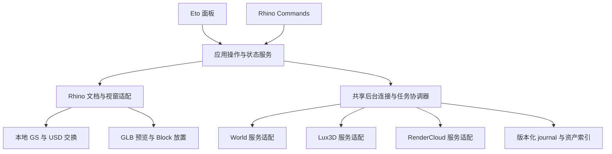

# Aholo for Rhino 开发推进计划：Lux3D 集成与交互重构

维护：**CuriousArc · qrost**

日期：**2026-11-08**

状态：**待实施的开发计划**。本轮只审计代码、形成计划；没有实现下述新功能，没有运行 Rhino 或调用需凭据的服务。供后续 agent session 分批执行。

## 1. 目标与范围

将 Aholo for Rhino 发展为一个围绕 **创建内容 → 管理资产 → 放入当前文档 → 渲染场景** 的完整插件：

- **World**：生成和查看 GS 世界；继续提供本地 GS 导入、导出与原生视窗显示。
- **Object / Lux3D**：生成单个网格模型，校验、预览、放置为 Rhino Block。
- **RenderCloud**：先贯通选中几何及生成模型的离线渲染，再独立推进实时预览研究。
- **一致的交互层**：面板与 command 共用操作服务；任务、资产、放置和显示状态清晰分开。

首个集成预览的交付范围是 World + Lux3D + 本地 GS + 基础离线渲染。实时云视窗和完整 PBR 另设门槛，不阻塞前述能力交付。不将“加入 Lux3D 标签页”当作集成完成。

保留 Aholo 的插件 GUID、包名、已有命令及用户数据。Lux3D 独立插件仍可共存。GSRhino 保持独立，**不修改其品牌、文档或代码，不引入对其已安装插件或邻接源码目录的运行依赖**。在 Aholo 内选择性迁入经过审查的实现、测试和许可说明；跨项目经验不等于当前版本已通过实机验收。

## 2. 审计基线与证据边界

| 项目 | 本轮读取基线 | 已有能力与证据 | 不能据此推定的结果 |
| --- | --- | --- | --- |
| Aholo | `fce2de7`，`0.1.1-beta.2` | World、离线 RenderCloud、GS PLY/USD 交换、实时协议库、自动中英语言。既有验证文档记录 314 项测试；用户已反馈较早版本 World/GS 基本流程通过 | 新版原生布局、完整 GS 生命周期、云渲染尺度/相机、Windows/Intel Mac 尚未全面验收 |
| Lux3D | `29a73ab`，`0.1.4-beta.4` | REST 生成、OAuth 账户登录、GLB 校验、预览、Block 放置、恢复与凭据隔离。既有记录 162 项测试 | OAuth 登录不等于生成授权；完整材质、当前界面及所有平台不等于已实测通过 |
| GSRhino | `dc90e5d`；功能代码基线 `a6f090a`，`0.1.0-beta.5` | 新增提交仅为图片；功能基线含更完整的显示状态、分数 DPI、缓存修复、SPZ/SPLAT、USD 语义验证。既有记录 296 项 .NET 测试及上一阶段 25 项真实 OpenUSD 检查 | 不能把自动化、图片或其他插件的成功反馈当成 Aholo 的完整宿主验收 |

本轮不重新运行上述测试，数字用于定位既有证据。执行者开始前须核对工作区和 HEAD，阅读 [架构](architecture.md)、[验证记录](validation.md)、[宿主验收](host-acceptance.md)、[GS 验收](gs-host-acceptance.md)。它们描述既有行为；本文描述下一阶段目标，不能将目标反写成现状。

官方网页复核：2026-11-08 读取了 [Quick Start](https://labs.aholo.ai/api-docs/en/quickstart) 与 [Authentication](https://labs.aholo.ai/api-docs/en/authentication)。前者仍将 World 定义为异步任务，并说明 generation 支持文字、单图或两者、进度可缺省；后者要求网关 `Authorization` 直接携带 API Key，无 `Bearer` 前缀。它们不证明任何具体账户的权限或额度。服务 OpenAPI JSON 本轮未能通过网页工具重新取得；RenderCloud 等详细能力以 [2026-11-01 仓内快照](api/README.md) 和当前实现为审计依据，实施云接口改动前必须重新比对官方规范，不能宣称本轮已确认其最新完整合同。

## 3. 现状诊断：优先解决流程问题

### 3.1 面板已有可用流程，但扩展空间不足

入口是 [AholoPanel.cs](../src/Aholo.Rhino/AholoPanel.cs)，当前为约 415 行单体面板，三个页签：World、RenderCloud、Connection。

| 已核实行为 | 对体验的影响 | 推进方向 |
| --- | --- | --- |
| World 页纵向混排输入、历史、多个下载按钮、尺度/轴、放置、本地导入导出、诊断和 World ID 恢复 | 用户难找下一步；主操作容易滚出视野；诊断与正常工作同级 | 按用户任务分区，固定主动作区；本地文件与结果详情集中到资产页；诊断进入高级区 |
| 固定高度列表/文本区，多个长按钮横排，大量技术说明常驻 | 英文和窄面板更容易拥挤，说明挤占工作区域 | 可伸缩列表、状态摘要、折叠详情、逐项错误、窄宽双布局 |
| `RunAsync` 用 `_busy` 禁用所有 `_actions`；`Poll` 也走该路径 | 后台查询/下载影响其他操作，用户感觉面板失去响应 | 按任务、操作和文档管理忙碌状态；浏览、选择、编辑草稿保持可用 |
| 每 8 秒轮询一个任务，隐藏面板停轮询 | 多任务时单任务实际刷新更慢；隐藏后渲染流程可能停止推进 | 显示最近查询时间；将任务协调器与面板可见性解耦，明确暂停策略 |
| 进度直接显示服务值；下载后只提示“保存到任务资产目录” | `0` 容易被理解为卡死；不知道文件在哪、是否已入文档 | 区分阶段、等待时长、查询新鲜度；结果提供“打开所在文件夹”和“放入/定位” |
| `PlaceSelectedAsync` 已能在缺 PLY 时下载后导入 | “先下载再放入”并非必要步骤，但界面暗示用户要多次点击 | 保留一键放入链路，以分阶段反馈解释下载、校验、插入、显示准备 |
| 导入使用面板捕获的文档 serial 与单位 | 已有正确的文档保护基础 | 新模式统一复用，禁止等待期间改向另一个活动文档 |

### 3.2 三个必须前置的集成断点

**A. 刷新并非纯查询。** [Workflows.RefreshCoreAsync / DownloadAsync](../src/Aholo.Sidecar/Workflows.cs) 在 mesh processing 成功后会提交 RenderCloud；下载先调用相同刷新逻辑。当前初次“上传并渲染”本来授权整个流程，不应破坏它，但必须把“查询状态”和“继续已授权流程”拆开，否则新任务中心的刷新、下载或重试可能产生用户未预期的收费动作。

**B. Lux3D 的结果目前不能直接走 Aholo 云渲染。** Lux3D 放置结果是 Block；[AholoHost.CaptureRender](../src/Aholo.Rhino/AholoHost.cs) 只接受 Mesh/Brep/Extrusion，明确拒绝实例。集成需要导出快照中的实例展开、变换与材质处理，不能要求用户破坏性 Explode。World GS Block 则是另一种资产，不能按普通三角网格处理。

**C. 同名字段不是同一合同。** Lux `TaskRecord.OperationId` 是本地 Guid、`TaskId` 是远端数字字符串；Aholo `LocalTask.Id` 是本地 Guid、`OperationId` 是远端 RenderCloud operation。两边 RPC 均写 `Version=1`，但协议并不兼容。禁止按字段名自动拼接、将服务 ID 转为浮点数、或直接连接另一个 sidecar。

### 3.3 任务服务和命令的实际欠缺

- [AholoClient](../src/Aholo.Core/AholoClient.cs) 当前随面板创建独立 sidecar，以单个 semaphore 串行 RPC；取消/通信错误会停止进程。仅调整按钮不能解决长请求阻塞。
- [TaskStore](../src/Aholo.Core/TaskStore.cs) 的全局 `.mutation.lock` 被长网络流程持有；不同面板不是自动排队。`Get/Recover` 不区分真实活跃 owner 与已中断操作，可能把另一面板仍在上传/提交的记录解释为中断或未知。
- `List` 仅最近 100 条，`ImportWorldAsync` 又以此去重。较旧 World ID 恢复可能产生重复本地记录；分页与全量身份查找应分离。
- 凭据存储共享、各 sidecar 内存连接分离；一个面板“断开并清除”不等于其他面板的内存凭据同时失效。
- [GaussianCommands](../src/Aholo.Rhino/GaussianCommands.cs) 异步导入/导出立即返回 `Result.Success`，使用 `CancellationToken.None`。导出命令提示可用面板取消，但面板的取消句柄并不属于该次命令操作。这是应修正的具体体验缺陷。
- `CaptureRender` 在 UI 线程读取、复制和网格化几何；后台只有后续 GLB 写盘。须测量并拆分可安全后台执行的阶段，不能称为“已全部异步”。

## 4. 推荐信息架构与按钮位置

继续使用原生 **Eto** 面板。先提取状态和操作服务，不在首阶段更换 WebView 技术栈。桌面原生选择、文件对话框、文档绑定和命令复用比新增前端框架更直接解决现有问题。

```text
Aholo                         [连接状态 / 设置]
目标文档：模型名 · 单位         [查看连接能力]
------------------------------------------------
[创建] [资产与任务] [渲染] [设置]

创建： [世界 / GS] [物体 / Lux3D]
       输入说明、提示词、参考图缩略图
       基础参数；[高级选项 ▾]
       当前任务摘要、阶段、耗时、最近查询时间

结果详情：缩略图 / 本地状态 / 尺寸与位置
          错误与恢复动作；[更多 ▾]
------------------------------------------------
固定动作区：主要动作          次要动作 / 本地取消
```

布局是目标示意，不代表已验证的最终视觉稿。先以虚拟任务数据做两种尺寸原型：约 360 px 宽的停靠面板和约 600 px 宽的浮动面板；窗口更窄时切换纵向按钮，禁止横向滚动。顶部只保留短状态，表单滚动，底部主动作保持可见；历史列表占剩余空间，不继续依赖固定高度堆叠。

| 页面 | 默认内容 | 主动作与位置 | 次要/高级动作 |
| --- | --- | --- | --- |
| 创建 | 先选世界或物体；输入规则随类型变化；显示对应服务连接能力 | 底部一个“生成世界”或“生成物体”，就近提示使用服务额度 | 图像选择/清除紧邻缩略图；面数/模型等放高级区；提交后原位显示任务卡及“查看结果” |
| 资产与任务 | 所有/世界/模型/渲染结果/本地文件筛选，搜索，分页，稳定选中项；本地导入入口在列表顶部 | 选中结果后，详情区同屏显示位置、尺度、轴、旋转及“放入当前文档”；已放入则“定位对象” | 下载原始格式、重新下载、打开所在文件夹、复制任务 ID、导出 GS、恢复 World ID、诊断在更多菜单 |
| 渲染 | 选中对象数量/类型、相机、输出比例示意、分辨率、基础材质支持范围；历史结果可回看 | 完成预检后底部“上传选择并渲染”，明确上传范围和服务费用 | 刷新选择快照、打开结果、保存副本；实验实时能力另设区域，未达门槛不伪装可用 |
| 设置 | API Key 与服务能力、可选账户登录、语言说明、运行时、存储和版本 | 明确的“验证连接”；本地功能始终不要求登录 | 本地 USD runtime 检查/安装说明；高级诊断与 probe；清理缓存需保护文档引用和撤销需求 |

交互规则：

1. 普通点击仅发起一次操作，立即给出可见反馈。清楚标示费用及上传范围的提交即授权该次工作流；不要为普通提交再加一遍相同确认。后续新增的收费操作必须有独立意图，不能借“重试”重新生成。
2. 生成参数在提交时快照；等待中编辑的新草稿不改变已提交任务。提示词、用户名称、路径和服务 ID 不翻译。
3. 输入验证就地显示，禁用按钮必须有原因。未选资产时显示空态，不等点击后才报“请选择任务”。
4. 下载成功同时显示“仅保存到本机，尚未放入文档”、可定位的文件入口和下一步。放置成功返回对象数量/所在图层；显示准备中、bbox、未切 GS 模式和缺失资产各有不同提示。
5. 详情中常用参数和当前结果同屏；不复制 Lux 现有“生成页调位置、任务页看候选”的来回切换。
6. 可选自动放置默认关闭；启用后绑定提交时文档/会话/单位/放置参数。关闭文档、关闭相应意图或重启后撤销自动放置，不在新活动文档悄悄补放。
7. Enter 在多行提示词中换行，不能意外触发收费。Tab 顺序按阅读顺序；取消可键盘到达；反馈不只依赖颜色。默认英文，Rhino 语言优先、系统语言回退，中文区域显示简体中文，保留数字区域格式。

## 5. 操作、状态与 command 合同

### 5.1 先分离五个状态维度

以下为**拟新增的内部类型/语义**，不是要求一次性重写全部历史 JSON 的字段名：

| 维度 | 最少表达内容 | 禁止混淆 |
| --- | --- | --- |
| 远程任务 | 未提交、提交中、提交未知、运行、成功、失败、取消；保留原始服务状态 | 云端成功不等于本地可用；查询失败不改写云任务为失败 |
| 资产 | 未下载、下载中、下载失败、校验中、校验拒绝、本地可用、丢失/损坏 | 校验失败不能重新创建付费任务 |
| 本地操作 | 排队、准备、可取消、提交文档、完成、部分完成、取消、失败 | 开始操作不是最终成功；进入不可中断原生提交时不能承诺即时取消 |
| 文档放置 | 未放入、已放入、撤销/删除、文档不可用；记录对象 IDs | 重复点击默认定位已有对象；“放入副本”为独立操作 |
| GS 显示 | 未识别对象、空/隐藏、加载、准备、无投影可见项、部分可用、完整帧、资源错误 | 空场景、只有 bbox、某一批完成均不表示完整显示成功 |

进度分阶段显示：服务有可信 `0..1` 进度时转换为百分比；缺省或长时间为 0 时显示阶段、已等待时间、最近成功查询时间及可执行动作。不能推测剩余时间或伪造增长进度。下载字节进度、GS 解析和视窗准备不拼成虚构的统一百分比。

### 5.2 动作语义冻结

| 动作 | 允许的副作用 | 重复/取消约束 |
| --- | --- | --- |
| QueryTask / Refresh | 查询原服务 ID并更新本地状态，可重新取得临时下载 URL | 不创建 World、模型、mesh processing 或 render job；对只读查询按服务规则退避 |
| ContinueAuthorizedRender | 继续初次渲染明确授权的上传→mesh processing→render 阶段 | 记录原意图、连接、输入/相机快照及阶段；提交前持久化屏障；回复未知停止，不宣称服务端 exactly-once |
| Download / RetryDownload | 下载原任务已有资产、验证、缓存 | 不调用生成/提交；失败保留原任务和原文件，取消写入不破坏有效缓存 |
| Place / Preview | 下载已有结果（若需要）、本地准备、校验目标、预览或插入 | 预览不写正式对象；一个正式操作一个 Undo；Zoom 失败与插入失败分开 |
| CancelLocal / PausePolling | 取消本地准备、撤销自动放置意图、暂停查询 | 不是云端取消或退款；取消中的 POST 结果未知需保留 journal |
| CreateNew | 明确创建一个新的收费意图 | 与恢复原任务分开；双击/快速重入不能意外生成两个任务 |

现有 Render 请求的 `requestId` 是追踪标识，不是已验证的幂等键。重启后可以只读恢复已知远端 ID；尚未提交的下一收费阶段默认暂停，呈现“继续原渲染流程”。只有能证明仍属于同一次有效授权且未提交的阶段才能继续；`SubmissionUnknown` 不能靠重发解决。

### 5.3 命令清单与职责

保留所有已有 EnglishName 与 GUID；中文只用于提示，不改命令标识。新增命令先登记唯一 GUID，验证命名冲突和帮助文档。

| 命令 | 状态 | 目标职责 |
| --- | --- | --- |
| `AholoPanel` | 已有，保留 | 打开同一文档的面板，恢复上次页签 |
| `AholoImportGs` / `AholoExportGs` | 已有，统一实现 | 调用操作服务；记录 operation ID，面板可查看/取消；脚本模式使用明确路径/选项而非强制弹窗 |
| `AholoGsMode` | 已有，保留 | 切显示模式/重试初始化，不负责生成、下载或重复插入 |
| `AholoGsDiagnostics` / `AholoGsProbe` | 已有，放高级入口 | 状态诊断与离线验收；probe 明示会新增测试几何 |
| `AholoImportPly` | 已有，保留兼容 | 仅点中心诊断，退出正常 GS 主流程，不能成为失败后的静默降级 |
| `AholoWorld` / `AholoModel` / `AholoRender` / `AholoTasks` | 拟新增 | 导航到对应页、保留草稿；执行命令本身不发起收费 |
| `AholoPlaceTask` | 拟新增 | 以本地 task ID、明确目标与放置选项操作，默认定位已有放置；命令退出后在安全 Idle 阶段提交，避免 Undo 冲突 |
| `AholoCancel` | 拟新增 | 选择/指定本地 operation ID，取消同一操作服务中的工作；不能含糊地表示云端任务取消 |

面板和命令不得保有各自独立的取消、busy、重复放置判定。异步 command 返回“已启动”时输出 operation ID，最终完成/失败通过同一记录和命令行反馈；Rhino 宿主的即时 `Result.Success` 不作为业务完成证据。凭据不作为可记录在命令历史中的明文参数。

## 6. 集成架构与迁移策略

### 6.1 分层与共享边界



- `Aholo.Core` 保留可移植合同、资产/GS逻辑；拟新增 `Aholo.Application`（或先用清晰目录）放不依赖 Rhino/Eto 的状态归约、动作能力、操作登记。是否独立程序集在 M1 决定，不能为了分层先搬动全部代码。
- `Aholo.Rhino` 负责 Eto 绑定、文档读写、原生选择/预览/显示；只有 UI 线程接触必须由宿主线程访问的对象。
- `Aholo.Provider` 与 `Aholo.Sidecar` 承载三种服务及凭据。迁入 Lux 功能后不要求用户安装独立 Lux 插件，不直接引用其 `.rhp`。
- 一个 Rhino 进程内的面板和 commands 共享协调器；先保持受控串行写入，再增加有界查询/下载并发。接口先解耦，不要求首批全面重写 IPC。UI 不应靠同步等待后台请求才能展示本地历史。
- 任务级 mutation ownership、文档提交锁和凭据作用域分别管理。缩短 journal 锁临界区；长网络调用不能占全库锁。持久 owner/租约恢复必须区分活跃进程和确实中断的操作，防止 PID 重用、崩溃或第二面板误接管。
- 同一用户启动两个 Rhino 进程时仍共用 TaskStore；进程内协调器不足以保证跨进程安全。任务所有权、原子发布和恢复需有跨进程证据，不能仅依赖内存锁；凭据清理也须明确跨进程生效范围。
- 面板关闭只是取消订阅和该面板自动放置意图，不等于撤销整个工作流。进程/文档关闭分别处理；断开当前连接与清除所有内存/持久凭据必须有准确范围，不能后台残留可用 key 却显示“全部断开”。

### 6.2 身份与数据迁移

拟统一索引：`SchemaVersion + ServiceKind + LocalTaskId + Region + ConnectionRef + typed RemoteIds`。WorldId、Lux TaskId、Render OperationId、MeshTaskId、MeshId 各保留独立字段和原字符串；输入快照、原始状态及来源记录可追溯。

| 迁移对象 | 决策 |
| --- | --- |
| 现有 Aholo journal | 向后兼容读取；增量添加 schema version；写新格式前备份，记录迁移版本/hash，失败不覆盖原件。保留未知字段/未支持版本并给恢复提示 |
| Lux 历史/缓存 | 首版可不迁移；若提供，必须用户显式导入副本或只读查看，保存来源标识/hash，不移动、覆盖或删除独立插件的数据 |
| API Key / OAuth | 不静默复制或接管旧插件凭据。Aholo 连接配置可由用户选择用于多服务，但分别验证能力；旧连接指纹不得“规范化”后导致历史失联 |
| Region | 新接口用明确枚举，适配 Lux `global/cn` 与旧指纹 `international/cn`；Aholo 当前仅 international。首版优先国际区；中国区若后续开放，只启用已核实的服务 |
| 旧 GS 文档引用 | 只读识别中性、版本化 schema，校验资产 SHA 与现有 placement；保留各自 GUID、显示模式、缓存/runtime 根目录。共存不双重绘制、不改写另一插件的引用 |
| Mesh 放置回执 | 新增版本化 Aholo receipt 与 user-string 命名空间。Lux 当前使用 `Lux3D.DirectPlacement.v1:` 身份种子及 `Lux3D.ImportId`、`Lux3D.AssetSha256`、`Lux3D.DocumentSession`、`Lux3D.GenerationOperationId`；不可原样复制后接管独立 Lux 对象。若兼容旧对象，采用明确的只读 adapter，并验证去重归属 |
| 文档身份 | runtime serial 只在当前 Rhino 会话有效；重启后恢复历史不能自动插入“看起来相同”的文档。正式提交前重新校验文档、会话、单位、可写性、command/Undo 状态 |

### 6.3 连接与能力模型

将 `Connected` 扩展为：账户登录状态、Key 是否配置/验证、各服务能力（未检查/可用/无权限/失败）、区域和额度状态。一次 World list 成功仅证明该调用可用；不得显示“所有服务就绪”或推算余额。

**OAuth 不作为生成前置步骤。** 可以在后续设置页复用 Lux 的账户登录能力，但必须分开显示“已登录”和“API Key 可用”。复用时保留固定 issuer、PKCE、state、回调校验、sidecar 内令牌及安全存储。不能把 OAuth token 作为 raw API Key，也不能把 MCP tools/list 成功当作生成权限。World/RenderCloud 与 Lux 的连接验证不应触发付费创建。

### 6.4 Lux3D 集成的能力边界

迁入当前受支持的 `G1-Turbo → GLB` 路线；先定义 capability registry 再显示模型选项。当前 Lux 文字与单图二选一，World 可文字加图，表单不能强行共用同一校验规则。未接入的 G1 ZIP 不展示成可用选项。

生成面数参数服从服务能力；**生成后导入 Rhino 不增加人为总顶点/面数上限，不静默减面**。文件结构、防溢出、解压与真实内存错误仍须处理。拒绝结构或资源失败时保留原文件、原任务及可复制诊断，绝不重新扣费生成。

复用 Lux 的 GLB validator/snapshot、输入快照、拒绝资产保留、`TaskPlacementService` 文档复核、单次 Undo、重复定位和阶段计时。候选预览也应分离文件准备与必须在 UI 线程执行的宿主导入；现有 Lux 预览并非全部异步，不能原样复制后宣称已解决卡顿。

## 7. GS 改进与渲染路线

### 7.1 优先吸收 GSRhino 已有修复

| 工作 | 借鉴的源文件/测试（位于独立 GSRhino 仓库） | Aholo 验收重点 |
| --- | --- | --- |
| 准确显示状态 | `GaussianDisplayStatus.cs`、`GaussianDisplayStatusTests.cs` | 空文档、隐藏、缺源、加载、零投影、部分成功、完整帧分别显示；空场景不启动无意义投影任务 |
| 分数 DPI 与视窗采样 | `GaussianFramePolicy.cs`、`GaussianViewport.cs`、`GaussianFramePolicyTests.cs` | 125%/150%、逻辑/设备像素交替、跨屏、真实 resize/camera变化；不能放松真正相机变化判断；缩略图不触发大场景重建 |
| 坏缓存恢复 | `GaussianReferenceAsset.cs`、`GaussianCachePublisher.cs`、`GaussianReferenceTests.cs` | 有效源可恢复坏缓存，保留损坏副本；并发只发布一次；取消不破坏现有缓存；placement 不变 |
| SPZ/SPLAT 解码 | `SpzReader.cs`、`SpzStreams.cs`、`SplatReader.cs` 及对应官方 fixture/tests | World 下载 SPZ 后可走统一查看/放置；明确版本/扩展支持，保留完整受支持 SH/opacity；不要求 Python，不转点云 |
| USD 语义与运行时 | `scripts/usd_bridge.py`、`UsdRuntime.cs`、`UsdRuntimeTests.cs`、`fixtures/usd-verify.py` | purpose/visibility/material binding 不静默丢弃；真实 OpenUSD 验证；安装包中检查运行时和显示设置指令，检测不能偷偷安装依赖 |

保持后台投影/排序、旧 generation 取消、每批最多 2,048 splats 的传输单位、共享 atlas/material、UI 线程原生资源回收、保存/缩略图保护。不回退到逐 Gaussian 创建原生对象。批大小不是总数限制。

USD/USDZ 在此阶段指静态 GS 交换，不等于任意 Mesh/Brep USDZ、所有厂商 schema 或动画。输出 float32 Gaussian 字段不宣称任意 double 输入逐位无损。两种 USD/普通网格需求必须在资产类型和导出范围上区分。

### 7.2 离线 RenderCloud 先贯通真实用户链路

新增“生成物体 Block → 选中并渲染”的实例快照导出：递归累积变换、非均匀/负缩放、法线、材质继承及嵌套实例；检测循环和失效定义。只展开导出副本，不修改原文档，只上传明确选择的对象。GS 代理不能误当 bbox 网格发送；发现未支持对象给出逐项报告，不能静默遗漏。

预检必须在任何上传前完成：对象清单、相机、视锥、输出比例、单位和支持的材质范围。先验收现有基本 diffuse 路线；完整 GLB PBR/纹理/灯光另列能力，不让界面暗示云图必然等于本机材质。用已知尺寸方块、轴标记、相同相机验证 fast ingestion 的尺度、方向和构图；需真实服务证据。

### 7.3 实时云视窗独立设研究门槛

既有 `RealtimeSession/RealtimePatchQueue/RealtimeStream` 和 mock tests 是协议基础，sidecar 尚无完整实时工作流入口与持久 cleanup journal。仓内合同当前仅提供 JPEG，不提供可用的 depth/alpha/object IDs/camera-frame association；GS prim 描述存在也不证明 World 资产已经能转为云 renderer 接受的 mesh/GS ID。

按三个层次推进，能力不足时停在上一层：

1. **独立云预览**：明确标记远端画面；session 建立、相机 patch 合并、断线、暂停、关闭及未确认 cleanup 可恢复。刷新不能重复创建 session，关闭不能遗失费用/资源清理义务。
2. **原生视窗内全场景远端画面**：证明上传场景与当前 Rhino 场景一致，显式规定编辑时的陈旧帧、交互、高亮与本地回退；不能简单把 JPEG 盖到仍在本地绘制的几何上就称为正确融合。
3. **本地/远端混合遮挡**：先取得并验证同相机/同尺寸的深度约定、帧关联、透明度处理及场景同步，或提出经过证明的完整替代方案。普通 JPEG 不足以实现任意本地 Mesh/NURBS/Brep/点云的正确遮挡。透明物体任意交错还需单独方案。

本地 GPU GS 后端也是独立 ADR/实验：先明确 Mac/Windows 渲染 API、资源生命周期与 reference oracle，再做 prototype。`Non-OpenGL` 不是 Metal 证据。不得通过隐藏 splats、缩减输入或用点云替代来宣称完成视觉/速度目标。

## 8. 分阶段任务与提交顺序

每个任务应形成一个可审阅的小提交或相关提交组；先完成依赖，再合入本地 main。下面的完成条件均为未来门禁，当前不勾选为完成。

| ID / 顺序 | 交付物与主要写范围 | 依赖 | 必须通过的完成条件 |
| --- | --- | --- | --- |
| **M0 基线与 CI** | 记录 HEAD/能力/命令/数据版本；补 Aholo 的 macOS+Windows build/test/package 工作流；元数据测试与 fixture 门禁；`docs`、`.github/workflows`、tests/scripts | 无 | 完整现有套件通过；直接解析 PE 校验 GUID/Publisher；检查实际包中资源/sidecar/runtime；不把构建或安装成功当宿主通过。agent 指令文件不进入包/版本控制 |
| **M1 合同与兼容层** | action capability、typed IDs、schema reader、服务能力表、全量身份查找+分页；`Aholo.Core` 与合同测试 | M0 | 旧 World/Render/Lux 样例可读；未知 schema 保留；大 ID 无损；恢复第 100 条以外任务不重复；未知提交不重新 POST |
| **M2 操作协调器与命令** | operation registry、面板订阅、取消、owner恢复、受控锁、拆 query/continuation；`Aholo.Application`（如采用）、Client/Sidecar、command adapters | M1 | 两文档及两个 Rhino 进程并行不会误判活跃任务、重复创建或覆盖 journal；长下载不阻塞本地浏览；命令启动能在面板取消；关闭/改单位/Undo竞争安全；Refresh/Download 不创建收费任务 |
| **M3A Eto 原型与正式绑定** | 四页结构、创建类型切换、固定主动作、任务详情、连接能力、渐进错误；先 fake data，后接 M2 | M1；正式接线依赖 M2 | 首次连接→生成→等待→放入、离线导入、失败恢复各有明确下一步；窄/宽、中/英、HiDPI、键盘验收；无全局 `_busy` 锁整页 |
| **M3B Lux3D 服务迁入** | 在 Aholo 内迁入 Provider/workflow/GLB validation/fixture；集成连接能力和任务 adapter | M1；交付依赖 M2 | G1-Turbo 文/单图合同、区域隔离、未知回复、下载坏包、大模型、取消、原文件保留均验证；不引用邻仓、不接管旧凭据 |
| **M3C GS 可靠性与格式** | 按第 7.1 节迁入纯逻辑及对应测试，先状态/DPI/cache，再 SPZ/SPLAT/USD | M0；应用接线依赖 M2 | 三项 P0 修复回归；真实 OpenUSD fixture；SPZ 从下载到显示走完整 GS；旧文档和共存不回退 |
| **M4 统一预览与放置** | GS/mesh 类型化预览与 placement receipt；位置/尺寸参数同屏；`Aholo.Rhino` host/services | M2、M3A/B；GS部分结合 M3C | 重复点击定位、显式副本、Undo/Redo、关闭/重开、单位变化；预览零正式对象；插入成功但 Zoom 失败可恢复；全量大模型不人为限面 |
| **M5 离线渲染闭环** | Block 快照展开、预检摘要、原意图续跑、结果预览/路径；Host/Geometry/Render workflow | M4 | 生成模型→放入→选中→云渲染贯通；已知尺寸/轴/相机实测；仅选中对象上传；未知渲染回复不重试创建；GS不被当网格误导出 |
| **M6 性能与发行验收** | 固定 benchmark、UI/文档生命周期矩阵、双语 README、打包/安装/发布证据 | M3C、M4、M5 | 完整 CI、实际安装包原生验收、逐文件一致性；按实际验收平台发包；所有未通过项明确保留为限制 |
| **R1 后置研究** | 云预览→原生全场景视窗→混合遮挡；或本地 GPU renderer；分别提交 ADR、原型和证据 | M2；不阻塞 M6 | 每一级先证明能力；不以 JPEG 展示、CPU 数值测试或空场景截图替代真实遮挡/性能证明 |

推荐先串行完成 M0→M1→M2，再并行 M3A/B/C。M4 是集中整合点，M5 明确完成跨能力闭环，M6 才考虑新的公开集成预览。不要一次把历史迁移、UI、SDK、GS 后端和云融合全部塞入同一提交。

## 9. 给后续 agent 的执行约束与分工

每个 session 先读本文件、当前 HEAD/dirty 状态、对应源代码和测试；以下分工是建议，不是越过真实文件锁/claim 的权限。

| 工作流 | 可独立认领范围 | 不应同时写的共享区域 |
| --- | --- | --- |
| 合同/协调 | Core contract、TaskStore、Client、Sidecar、应用状态测试 | `Contracts.cs`、`Program.cs`、连接/任务 schema 由一个负责人整合，先冻结接口 |
| UI | Eto 页面组件、view binding、资源 key、布局验收文档 | 不另造 task/credential 状态；共享语言 JSON 由指定整合者合并，避免全文件重排 |
| Lux 服务 | 新增服务适配、GLB 纯逻辑、Provider tests、迁入来源清单 | 不并行改协调器和总 dispatcher；提交接口 patch 给整合者 |
| GS | GS Core、viewport/cache/formats、fixtures与USD bridge | 不顺带重构所有面板/connection；不写 GSRhino 仓库 |
| Host 集成/Render | 文档快照、Block展开、placement、command adapters | 等 M2 接口冻结；与 GS renderer 的 Rhino 原生生命周期改动分开审查 |

每次交付包含：基线/提交号、修改范围、验证命令与结果、未验证平台/服务、迁移及回滚方式、下一任务的具体入口。检查 staged diff 后提交；不夹带其他 session 修改。文档准备不授权执行后续付费调用或发布，执行者应依当前会话授权推进。用户手动进行 Rhino 原生验收，agent 可做已授权的 CLI 构建/安装，不用 computer use 控制其桌面。

## 10. 验收矩阵与速度目标

### 10.1 必需自动化

- **合同/恢复**：三类 provider 的状态、ID、region、连接归属；未知提交、重启、双击、跨面板 owner、只读刷新、费用阶段屏障、分页/旧任务恢复。
- **操作/文档**：命令与面板同一 operation；取消和 completion race；目标关闭/切换/改单位；重复放置、删除与 Undo 后重新放置；进程恢复不自动往新文档提交。
- **资产**：完整 GLB/GS 结构、格式/内容不匹配、损坏/丢失缓存、并发写入、hash、原文件保留、SPZ/SPLAT 与 USD 真实 fixture；不存在隐藏的几何总数上限或自动减面。
- **显示**：空/部分/完整状态、分数 DPI、相机变化/深度稳定、缩略图隔离、native 资源释放；CPU oracle 作为数值对照，不作为宿主图像验收。
- **发行**：全 solution 构建/测试、语言资源/格式参数、PE 元数据、候选包合成故障测试、包内 allowlist/hash、实际 sidecar/runtime 位置、安装字节核对。吸取 Tripo 元数据测试教训：新增 Rhino 属性后，hostless 测试不可使用会触发 RhinoCommon 加载的运行时反射。

现有关键回归不可弱化：`LostGenerationReplyIsNotAutomaticallySubmittedAgain`、`RenderContinuationOnlySubmitsOnceThenPollsByOperationId`、`RecoveredRenderIntentDoesNotRepeatPaidSubmission`、`DifferentKeyCannotPollOrDownloadEarlierAccountTask`、`JournalRecoversUncertainSubmissionAndDropsSignedUrls`、`FailedDeleteRetainsCleanupObligationAndAllowsExplicitRetryOnly`。重构改变方法名时保留其行为覆盖。

基础执行入口（以执行时仓库脚本为准，不声称本轮已运行）：

```sh
dotnet build Aholo.sln -c Release
dotnet test Aholo.sln -c Release --no-build
python3 scripts/create-gs-assets.py --check
dotnet run --project tools/Aholo.Reference -c Release -- --output artifacts/gs-reference
./scripts/build-package.sh --platform mac
```

USD 部分还要运行实际私有 runtime 下的 fixture 验证；Windows CI/安装脚本与 macOS 分别留证。不要为了 metadata 测试把 RhinoCommon 运行库复制进产品包，也不要跳过失败测试来恢复绿灯。

### 10.2 原生体验验收

| 场景 | 必须观察的结果 |
| --- | --- |
| 无 Key / 离线 | 本地 GS 导入导出、缓存查看和诊断可用；需要联网/凭据的动作说明原因 |
| World 等待 0 进度 | 看到运行阶段、等待时长、最近查询和恢复入口，不假报停机或自动重发 |
| 原任务放入 | 自动补齐下载，显示路径；放置、显示准备和可见性分开；重复点击不重复添加 |
| Lux 模型闭环 | 从物体输入到 GLB预览/Block放置，再到选中渲染；大模型完整保留 |
| command ↔ panel | 从命令启动的长操作出现在面板，取消和终态一致；关闭面板不丢 journal |
| 多文档/会话 | 切换、关闭、重开、变更单位、撤销/重做、其他命令执行期间不误投文档 |
| 两个 Rhino 进程 | 同一任务的提交/查询/下载互斥或可见排队；不误恢复活跃 owner、不重复收费、不覆盖 journal；一方崩溃后有证据地恢复，不误清理另一方凭据 |
| GS 原生显示 | opaque Mesh、Brep/NURBS、点云的前后/交叉遮挡与高亮，多 clipping planes，多视窗、跨屏；透明混合单列未支持项 |
| 资源/存储 | 缺源/坏缓存有明确状态和恢复；缓存清理不破坏当前文档及恢复路径 |
| 布局 | 英文/中文、窄停靠/宽浮动、DPI、长任务名、长路径、键盘焦点；主要按钮无需寻找或横向滚动 |
| 多插件共存 | 与独立 Lux/GSRhino 同时安装、模式切换、旧 3dm 恢复；无 GUID/命令冲突、双重绘制、凭据或缓存互删；同一旧任务及其 Undo/删除后的放置去重不越过对象所有权 |

Apple Silicon、Intel Mac、Windows 分开记录；不能把 portable managed build 或另一个项目截图算作对应平台通过。云付费验收使用用户明确授权的测试预算和样例，记录服务/模型/资产 hash、请求与结果标识，不记录密钥或签名 URL。

### 10.3 性能测量与优化顺序

先固定机器/Rhino版本/后端、资产 hash、GS/面数、单/多视窗与相机轨迹，记录：文件读取、解码、缓存、投影、排序、最长 UI 上传批次、首个完整帧、持续导航、峰值内存、取消至停止延迟。云侧另记录上传、查询、mesh processing 和 render 时间，不混入本地速度统计。

可先采用的**待验证目标**：常规按钮点击在约 100 ms 内反馈；可切片的 UI 工作争取每片不超过约 8 ms；长操作不锁住历史浏览和草稿编辑。不能切片的原生网格化/导入调用单独披露耗时和取消边界。以实际 baseline 决定后续帧率与内存预算，不在无测量时承诺固定 FPS 或“不会卡顿”。

优先优化状态准确、取消失效工作、缓存复用、锁与调度、分阶段反馈，再研究 GPU。Rhino 仍受内存和宿主 API 限制；没有产品人为总数阈值不代表物理资源无限。

## 11. 发布与退出条件

集成预览至少满足：M0–M5 的必要合同和主链路完成，M6 的自动化与拟发布平台宿主检查有证据；没有未知提交自动重放、误投文档、无法取消的伪提示或无记录的数据迁移。没有通过的平台继续预览/待验收，不使用 `any` 掩盖缺失实测。

更新英文 `readme.md`、中文 `readme.zh-CN.md`、manifest、命令清单、格式支持、OAuth/API Key说明及平台限制。署名统一 CuriousArc / qrost，保留第三方许可。记录包 SHA、源提交、安装逐文件校验和实际 Yak 列表；CI、打包、安装、公开上传与原生验收是不同证据。

回滚：功能开关可撤回新 Lux/云预览入口；旧任务/源资产与旧版本包保留；新 schema 读写有备份和明确兼容策略。不能通过降级删除用户新任务、重写旧连接指纹、卸载独立插件或重复生成来恢复。

## 12. 后续执行者的源码索引

以下源码链接用于核对行为；跨仓链接固定审计 revision，执行前再检查实际版本。

- Aholo：[Panel](../src/Aholo.Rhino/AholoPanel.cs)、[Plugin/基础命令](../src/Aholo.Rhino/AholoPlugin.cs)、[GS commands](../src/Aholo.Rhino/GaussianCommands.cs)、[Host/CaptureRender](../src/Aholo.Rhino/AholoHost.cs)、[Workflows](../src/Aholo.Sidecar/Workflows.cs)、[Contracts](../src/Aholo.Core/Contracts.cs)、[TaskStore](../src/Aholo.Core/TaskStore.cs)、[Client](../src/Aholo.Core/AholoClient.cs)、[实时会话](../src/Aholo.Provider/RealtimeSession.cs)、[GS设计与能力门槛](decisions/0001-native-gaussian-viewport.md)。
- Lux3D：[固定源码树](https://github.com/QROST/lux3D-rhino/tree/29a73abbdd50587036930ba6c45436dcd6da2ea9/src)。优先阅读 `Lux3D.Core/Workflow.cs`、`TaskStore.cs`、`Contracts.cs`、`GlbContainerValidator.cs`、`GlbImportSnapshot.cs`；`Lux3D.Rhino/TaskPlacementService.cs`、`Lux3DHostService.cs`、`PlaceTaskCommand.cs`、`Lux3DPanel.cs`；`Lux3D.Provider/ManycoreOAuthService.cs`、`OAuthMcpProbe.cs`、`Contracts.cs`，以及同 revision 的 `docs/provider-contract.md`、`docs/verification.md`。
- GSRhino：[固定功能源码树](https://github.com/QROST/GaussianSplattingRhino/tree/a6f090a3749dc1308ded04473028db956910ee9f/src)。第 7.1 节纯逻辑文件主要位于 `GSRhino.Core`，宿主适配位于 `GSRhino.Rhino`；对应 `tests/GSRhino.Tests`、`scripts/usd_bridge.py` 和 `fixtures/usd-verify.py` 随修复一起评审，不只复制生产代码。

**建议下一 session 从 M0 开始：先建立可复核基线与全量 CI，再冻结 M1 的身份、动作和迁移合同。UI 原型可以同期探索，但不得绕过 M1/M2 将收费和放置逻辑继续写进面板事件。**
